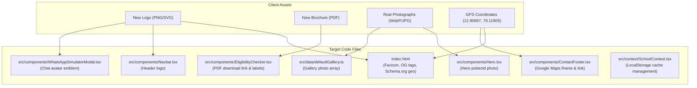

# Comprehensive Project Audit & Asset Preparation Report
## Olive Tree School, Kaspa, Vellore

**Date:** November 2026  
**Project Repository:** `https://github.com/Mohammad-Nadeem-08/olive-tree-school-vellore`  
**Working Directory:** `c:\Users\ELCOT\Desktop\School_Website\website01`  
**Audit Status:** Complete — Static Inspection & Asset Mapping (Read-Only Audit Phase)

---

## Executive Summary

This audit establishes a complete technical and asset baseline for **Olive Tree School, Vellore** ahead of four planned client modifications:
1. **School Logo Replacement:** Replacing the low-contrast JPEG logo with a newly designed transparent vector/PNG brand mark.
2. **Brochure Replacement:** Transitioning from a single image-based pamphlet (`.jpg`) to an official, multi-page vector PDF brochure.
3. **Google Maps Location Update:** Upgrading from a generic Kaspa map query to the precise school building coordinates (`12°54'25.1"N 79°07'08.6"E`).
4. **Authentic Photography Migration:** Replacing all stock Unsplash placeholder images with real photographs of the school building, students, classrooms, and activities.

> [!IMPORTANT]
> **Zero Code Modifications Guarantee:** No existing application code, stylesheets, or tracked assets have been modified, overwritten, or deleted during this audit phase.

---

## 1. Project Architecture Overview

### 1.1 Technical Stack
- **Framework:** React 19.2.8 with TypeScript (~6.0.2)
- **Build Tooling:** Vite 8.3.0 (`@vitejs/plugin-react` 6.1.1)
- **Styling Engine:** Tailwind CSS v4.3.3 via `@tailwindcss/vite`
- **Animation & Motion:** Framer Motion 14.3.0
- **Iconography:** Lucide React 1.59.0
- **Linting:** Oxlint 1.81.0

### 1.2 Architectural Highlights
- **Single-Page Application (SPA):** Clean, modular component tree rendered inside `src/App.tsx`.
- **Trilingual Localization Engine:**
  - Full natural language switching for **English (`en`)**, **Tamil (`ta`)**, and **Urdu (`ur`)**.
  - Dynamic text directionality (`dir="rtl"` automatically enabled for Urdu with Noto Nastaliq Urdu typography).
  - Central dictionary located at `src/data/translations.ts`.
- **Dual-Theme Engine (Light & Dark Mode):**
  - Controlled via `SchoolContext.tsx` with View Transitions API integration.
  - CSS Custom Variables defined in `src/index.css` (`--bg-page`, `--text-primary`, `--accent-cta`).
- **Interactive Admin System & LocalStorage State:**
  - Secure in-browser admin mode authenticated with credentials `admin` / `olive2026`.
  - Configurable phone numbers, admission year, notice board items, and campus gallery photos stored in browser `localStorage`.
- **Static Asset Serving Pipeline:**
  - Files placed in `/public/` are served at the root URL `/` by Vite during both development and production builds.
  - Vercel SPA routing configured via `vercel.json` (`rewrites: [ { "source": "/(.*)", "destination": "/index.html" } ]`).

---

## 2. Existing Asset Inventory

An exhaustive file-by-file audit of all media assets in the project:

| Asset Path | File Type | File Size | Dimensions | Current Project Role | Status & Action |
|---|---|---|---|---|---|
| `public/olive-logo.jpeg` | JPEG Image | 63.5 KB (63,501 bytes) | 1280 × 578 px | Current school logo (Navbar, WhatsApp modal avatar, OpenGraph preview, Schema.org) | **Replace** (Lacks alpha transparency; white box on dark backgrounds) |
| `public/olive-pamphlet-2026.jpg` | JPEG Image | 956 KB (956,496 bytes) | 896 × 1200 px | Current admission pamphlet / brochure download in EligibilityChecker | **Replace** (Raster image; replace with high-res printable PDF) |
| `public/brainy-stars-logo.jpeg` | JPEG Image | 44.5 KB (44,525 bytes) | 362 × 197 px | Official co-branding partner logo (*Brainy Stars International School*) | **RETAIN** (Preserve institutional partnership co-branding) |
| `public/favicon.svg` | SVG Vector | 9.5 KB (9,522 bytes) | 48 × 46 viewBox | Default Vite lightning bolt icon in browser tab (`index.html`) | **Replace** (Replace with school olive tree crest favicon) |
| `public/icons.svg` | SVG Sprite | 5.0 KB (5,031 bytes) | Vector Symbols | Vite template social icons (Bluesky, Discord, GitHub, X) — unreferenced in `src` | **Orphaned** (Candidate for safe cleanup in later phase) |
| `public/audio/*.mp3` (12 files) | MP3 Audio | ~30–70 KB each | Stereo Audio | Arabic recitations & trilingual meanings for 3 daily Sunnah Duas | **RETAIN** (Authentic audio recordings for LearningCorner) |
| `src/assets/hero.png` | PNG Image | 13.0 KB (13,057 bytes) | 343 × 361 px | Unreferenced residual file from early mockup | **Orphaned** (Unused by any component) |
| `src/assets/react.svg` | SVG Vector | 4.1 KB (4,126 bytes) | Vector | Vite template default asset — unreferenced in `src` | **Orphaned** (Unused) |
| `src/assets/vite.svg` | SVG Vector | 8.7 KB (8,709 bytes) | Vector | Vite template default asset — unreferenced in `src` | **Orphaned** (Unused) |
| *External Unsplash Photo 1* | WebP/JPEG (CDN) | Dynamic | 1000 × 750 px | Primary Hero Section children photo collage (`src/components/Hero.tsx`) | **Replace** with real student classroom photograph |
| *External Unsplash Photo 2* | WebP/JPEG (CDN) | Dynamic | 1200 × 800 px | Gallery Item 1 — Smart Classroom (`src/data/defaultGallery.ts`) | **Replace** with real Olive Tree classroom photograph |
| *External Unsplash Photo 3* | WebP/JPEG (CDN) | Dynamic | 1200 × 800 px | Gallery Item 2 — Quran Halaqah (`src/data/defaultGallery.ts`) | **Replace** with real Quran Tajweed circle photograph |
| *External Unsplash Photo 4* | WebP/JPEG (CDN) | Dynamic | 1200 × 800 px | Gallery Item 3 — Sports Day (`src/data/defaultGallery.ts`) | **Replace** with real Sports Day / outdoor activities photograph |

---

## 3. Logo Replacement Analysis

### 3.1 Every Location Referencing the Logo
1. **`index.html` (Lines 5, 20, 29, 39, 40):**
   - Line 5: `<link rel="icon" type="image/svg+xml" href="/favicon.svg" />` *(Currently default Vite icon)*
   - Line 20: `<meta property="og:image" content="/olive-logo.jpeg" />` *(Social sharing preview on WhatsApp/FB)*
   - Line 29: `<meta name="twitter:image" content="/olive-logo.jpeg" />` *(Twitter / X card image)*
   - Line 39: `"logo": "https://olivetreeschool.in/olive-logo.jpeg"` *(Google Schema.org structured data)*
   - Line 40: `"image": "https://olivetreeschool.in/olive-logo.jpeg"` *(Google Schema.org school image)*
2. **`src/components/Navbar.tsx` (Lines 46–51):**
   - Main header logo:
     ```tsx
     
     ```
3. **`src/components/WhatsAppSimulatorModal.tsx` (Lines 82–86):**
   - Chat identity avatar in admission modal:
     ```tsx
     
     ```
4. **`src/components/ContactFooter.tsx` (Lines 280–297):**
   - Currently uses a stylized icon badge (`<TreePine className="w-5 h-5 text-white" />`) with text branding rather than a raster image. Can incorporate the new emblem logo if requested.

### 3.2 Technical Assessment of Current Logo
- **Format:** JPEG (`.jpeg`) with a solid white/off-white background.
- **Drawbacks:**
  - In dark mode (`#0E1714`), the logo renders as an opaque white rectangle, breaking the seamless dark-mode aesthetic.
  - Standard JPEG raster compression introduces fuzzy artifacts around typography ("learn to live").
- **Co-Branding Separation:** The logo for partner school *Brainy Stars International School* (`/brainy-stars-logo.jpeg`) is distinct and must be kept separate from the primary Olive Tree School brand identity.

### 3.3 Recommendations for Replacement Logo
1. **Format:** **24-bit PNG with alpha transparency** (`.png`) and/or clean vector **SVG** (`.svg`).
2. **Asset Deliverables:**
   - **Horizontal Lockup (`olive-tree-logo.png`):** Minimum `1200 × 400 px` (aspect ratio ~3:1). Ideal for desktop and mobile navigation headers.
   - **Square Emblem / Crest (`olive-tree-emblem.png`):** `512 × 512 px` (aspect ratio 1:1). Perfect for the circular WhatsApp chat avatar, browser favicon, and mobile home screen app icon.
   - **Dark Mode Variant (`olive-tree-logo-dark.png`):** *(Optional)* If the primary logo typography uses dark forest green or black text, a variant with white/gold typography is recommended for dark theme backgrounds.
3. **Favicon Assets:**
   - Vector `favicon.svg` (for modern browsers).
   - Multi-resolution `favicon.ico` (16x16, 32x32, 48x48) for legacy compatibility.

---

## 4. Brochure Replacement Analysis

### 4.1 Current Implementation
- **Current File:** `public/olive-pamphlet-2026.jpg` (Single JPEG image, 896 × 1200 px, ~934 KB).
- **Referencing Component:** `src/components/EligibilityChecker.tsx` (Lines 742–759):
  ```tsx
  <a
    href="/olive-pamphlet-2026.jpg"
    target="_blank"
    rel="noopener noreferrer"
    download="Olive_Tree_School_Admission_Pamphlet_2026-27.jpg"
    className="..."
  >
    <Download className="w-4 h-4" />
    <span>{language === 'ta' ? 'சிற்றேடு பதிவிறக்குக' : language === 'ur' ? 'بروشر ڈاؤنلوڈ کریں' : 'Download Brochure'}</span>
    <ExternalLink className="w-3.5 h-3.5" />
  </a>
  ```
- **Trilingual Action Labels:**
  - English: `"📥 Download Official 2026–27 Admission Pamphlet"`
  - Tamil: `"📥 அதிகாரப்பூர்வ 2026-27 சேர்க்கை சிற்றேடு பதிவிறக்கம்"`
  - Urdu: `"📥 رسمی داخلہ پمفلٹ 2026-27 ڈاؤنلوڈ کریں"`
- **Behavior:** It functions as a dual-action trigger: it opens in a new browser tab (`target="_blank"`) while also prompting a file download (`download="..."`).

### 4.2 Limitations of Current Brochure
- As a single JPEG image, multi-page school information cannot be comfortably read on mobile devices.
- Text within the JPEG is rasterized, making it unsearchable, blurry when zoomed, and inaccessible to screen readers.
- Contact numbers, WhatsApp links, and website URLs cannot be clicked.

### 4.3 Recommendations for Replacement Brochure
- **Format:** High-resolution printable **PDF (`.pdf`)**.
- **Recommended Filename:** `olive-tree-school-brochure-2026.pdf` (stored in `public/assets/brochure/`).
- **File Size Target:** Under 8 MB for rapid mobile downloading over 4G connections.
- **Optional Visual Preview:** If a visual thumbnail of the brochure cover is desired in the Eligibility section, supply an image `olive-tree-school-brochure-preview.webp` (`800 × 1130 px`, ~A4 aspect ratio).

---

## 5. Real Image Replacement Audit

A comprehensive review of every visual image slot across all pages and components:

| # | Section / Component | Current Image Path | Current Purpose | Nature of Existing Asset | Action Required | Recommended Client Photograph |
|---|---|---|---|---|---|---|
| **1** | **Hero Section** (`src/components/Hero.tsx` L265) | `https://images.unsplash.com/photo-1588072432836-e10032774350...` | Polaroid visual card showcasing students engaged in study | **Stock Photo (Unsplash)** | **REPLACE** | High-quality photo of Olive Tree School students in real uniforms smiling and learning together in an authentic classroom. (Landscape 4:3, min 1200×900 px). |
| **2** | **Campus Gallery — Classrooms** (`src/data/defaultGallery.ts` L6) | `https://images.unsplash.com/photo-1580582932707-520aed937b7b...` | Photo #1 in default gallery: "Interactive Smart Classroom & Joyful Montessori Exploration" | **Stock Photo (Unsplash)** | **REPLACE** | Authentic photo of Grade 1–5 academic classrooms showing desks, interactive displays, or students writing. |
| **3** | **Campus Gallery — Tarbiyah** (`src/data/defaultGallery.ts` L15) | `https://images.unsplash.com/photo-1609599006353-e629aaabfeae...` | Photo #2 in default gallery: "Quran Tajweed Circle & Daily Sunnah Supplications" | **Stock Photo (Unsplash)** *(Generic flatlay of Quran & prayer beads)* | **REPLACE** | Real photo of students during morning Quran Tajweed recitation or Islamic Tarbiyah / Duas session with their Ustadh/Teacher. |
| **4** | **Campus Gallery — Activities** (`src/data/defaultGallery.ts` L24) | `https://images.unsplash.com/photo-1577896851231-70ef18881754...` | Photo #3 in default gallery: "Annual Sports Day & Healthy Sunnah Physical Fitness" | **Stock Photo (Unsplash)** *(Generic race track)* | **REPLACE** | Real photo of students participating in Annual Sports Day, physical fitness drills, or outdoor campus games. |
| **5** | **Campus Gallery — Expansion Slot 4 (Exterior)** *(New)* | None | Showcase physical school campus building and entrance in Kaspa, Vellore | N/A | **ADD** | Clear daylight photograph of the Olive Tree School building facade, school name board, and entrance gate. |
| **6** | **Campus Gallery — Expansion Slot 5 (Nursery/Montessori)** *(New)* | None | Showcase early years (Pre-KG / LKG / UKG) learning spaces | N/A | **ADD** | Pre-KG Montessori activity room showing sensory play equipment, low tables, and colorful learning aids. |
| **7** | **Campus Gallery — Expansion Slot 6 (Facilities/Lab)** *(New)* | None | Showcase STEM & Smart Lab facilities | N/A | **ADD** | Students in the school computer lab using desktop systems or performing hands-on science experiments. |
| **8** | **Partner Co-Branding Logo** (`src/components/Hero.tsx` L137 & `AboutSection.tsx` L179) | `/brainy-stars-logo.jpeg` | Displays official association with Brainy Stars International School | Institutional Partner Logo | **RETAIN** | Keep as-is. (Only update if the client supplies an updated official Brainy Stars asset). |
| **9** | **Browser Tab Favicon** (`index.html` L5) | `/favicon.svg` | Browser tab icon and bookmark shortcut | **Placeholder (Default Vite Logo)** | **REPLACE** | Clean SVG or PNG icon version of the new Olive Tree School emblem. |
| **10** | **Unreferenced Assets** (`src/assets/hero.png`, `react.svg`, `vite.svg`, `public/icons.svg`) | `src/assets/*`, `public/icons.svg` | Residual starter template assets | **Orphaned Boilerplate** | **FLAG FOR CLEANUP** | Retained untouched during audit; scheduled for safe cleanup during implementation. |

---

## 6. Recommended Asset Folder Structure

To ensure clean separation between source code and public assets, the following organized directory structure has been created inside `public/assets/`:

```
public/
├── audio/                                  # RETAINED: 12 authentic trilingual Dua audio files
│   ├── dua-1-ar.mp3 ... dua-3-ur.mp3
│
├── brainy-stars-logo.jpeg                  # RETAINED: Partner co-brand logo
│
└── assets/                                 # CREATED STAGING DIRECTORY
    ├── branding/
    │   ├── olive-tree-logo.png             # Primary horizontal logo (transparent PNG/SVG)
    │   ├── olive-tree-logo-dark.png        # (Optional) Dark mode contrasting logo
    │   ├── olive-tree-emblem.png           # Square icon / WhatsApp avatar (512x512)
    │   ├── favicon.svg                     # Vector browser tab icon
    │   └── favicon.ico                     # Standard browser tab icon
    │
    ├── brochure/
    │   ├── olive-tree-school-brochure-2026.pdf      # Official admission brochure PDF
    │   └── olive-tree-school-brochure-preview.webp  # (Optional) High-res cover image
    │
    └── school/
        ├── hero/
        │   └── hero-students-classroom.webp         # Primary Hero section photograph (4:3)
        │
        ├── exterior/
        │   ├── school-building-facade.webp          # Building exterior / elevation
        │   └── school-entrance-gate.webp            # Entrance gate & board
        │
        ├── classrooms/
        │   ├── primary-smart-classroom.webp         # Grade 1–5 academic room
        │   └── nursery-montessori-room.webp         # Pre-KG / Montessori sensory room
        │
        ├── tarbiyah/
        │   ├── quran-tajweed-circle.webp            # Quran recitation halaqah
        │   └── daily-sunnah-etiquettes.webp         # Character building & Akhlaq session
        │
        ├── activities/
        │   ├── sports-day-athletics.webp            # Sports, PT drills, race
        │   └── arts-creative-activities.webp        # Calligraphy, science expo, art
        │
        └── facilities/
            ├── computer-smart-lab.webp              # Smart lab & computer systems
            └── outdoor-play-area.webp               # Campus playground & outdoor play
```

> [!NOTE]
> All eight staging subdirectories have been created under `public/assets/` on disk and are completely ready to receive the client's asset files.

---

## 7. Exact Filenames Client Needs to Provide

When collecting assets from the client, use these standardized filenames:

### 7.1 Branding & Identity Assets
1. `olive-tree-logo.png` — Main horizontal logo with transparent background (1200×400 px).
2. `olive-tree-emblem.png` — Square crest / symbol only (512×512 px) for avatars and icons.
3. `favicon.svg` (or `favicon.png`) — Favicon icon for browser tabs.
4. *(Optional)* `olive-tree-logo-dark.png` — Horizontal logo tailored for dark backgrounds.

### 7.2 Academic Brochure
1. `olive-tree-school-brochure-2026.pdf` — Official school prospectus & admission brochure (Printable PDF).

### 7.3 School Photographs
1. `hero-students-classroom.webp` (or `.jpg`) — Hero section feature photograph (Students in uniform studying joyfully; 4:3 landscape, 1600×1200 px).
2. `primary-smart-classroom.webp` — Primary academic classroom in session.
3. `nursery-montessori-room.webp` — Pre-KG Montessori activity and sensory room.
4. `quran-tajweed-circle.webp` — Quran recitation, Tajweed, or Morning Dua session.
5. `daily-sunnah-etiquettes.webp` — Students practicing Akhlaq / Islamic etiquette.
6. `sports-day-athletics.webp` — Sports day, race, athletics, or PT drill.
7. `school-building-facade.webp` — School exterior building and facade in Kaspa, Vellore.
8. `school-entrance-gate.webp` — School entrance gate with Olive Tree sign board.
9. `computer-smart-lab.webp` — Modern computer lab with students.
10. `outdoor-play-area.webp` — Children enjoying playground equipment/swings.

---

## 8. Google Maps Location Audit

### 8.1 Location Coordinates Comparison
- **Existing Configured Location:**
  - Latitude: `12.9165`
  - Longitude: `79.1325`
  - Current Address String: `"Chinayya Layout, Behind Janipoonthattam, Kaspa, Vellore - 632 001"`
  - Description: Generic center coordinate for Kaspa, Vellore.
- **Client's New Official School Location:**
  - Google Maps URL: `https://www.google.com/maps/place/12%C2%B054'25.1%22N+79%C2%B007'08.6%22E/@12.9069697,79.116472,17z/data=!3m1!4b1!4m4!3m3!8m2!3d12.9069697!4d79.1190469`
  - Decimal Coordinates:
    - **Latitude:** `12.9069697` (approx. `12.90697`)
    - **Longitude:** `79.1190469` (approx. `79.11905`)
  - DMS Coordinates: **12°54'25.1"N, 79°07'08.6"E**

### 8.2 Codebase Modification Mapping for Maps

| File | Exact Line Numbers | Existing Code / Link | Required Update |
|---|---|---|---|
| `src/components/ContactFooter.tsx` | Lines 217–227 | `src="https://maps.google.com/maps?q=Kaspa,+Vellore,+Tamil+Nadu+632001&t=&z=15&ie=UTF8&iwloc=&output=embed"` | Update iframe `src` to exact coordinates with high zoom level:<br>`https://maps.google.com/maps?q=12.9069697,79.1190469&t=&z=17&ie=UTF8&iwloc=&output=embed` |
| `src/components/ContactFooter.tsx` | Lines 239–246 | `<a href="https://maps.google.com/?q=Kaspa,+Vellore,+Tamil+Nadu+632001"...>Open Map ↗</a>` | Update direct navigation URL:<br>`https://www.google.com/maps/place/12%C2%B054'25.1%22N+79%C2%B007'08.6%22E/@12.9069697,79.1190469,17z` |
| `index.html` | Lines 52–56 | `"geo": { "@type": "GeoCoordinates", "latitude": "12.9165", "longitude": "79.1325" }` | Update Schema.org GeoCoordinates:<br>`"latitude": "12.9069697"`,<br>`"longitude": "79.1190469"` |
| `src/context/SchoolContext.tsx` | Line 13 | `address: 'Chinayya Layout, Behind Janipoonthattam, Kaspa, Vellore - 632 001'` | Verify with client if address text requires specific building/landmark refinements. |

---

## 9. Comprehensive List of Files Requiring Modification

When implementation is approved, modifications will be isolated to the following files:



### Detailed File Change Checklist:
1. **`index.html`**:
   - Update `favicon.svg` link.
   - Update `og:image` and `twitter:image` to new logo / hero image.
   - Update Schema.org `"logo"`, `"image"`, and `"geo"` (`latitude`, `longitude`).
2. **`src/components/Navbar.tsx`**:
   - Update logo `src` from `/olive-logo.jpeg` to `/assets/branding/olive-tree-logo.png`.
   - Add dark-mode conditional logo class/src if dark variant provided.
3. **`src/components/WhatsAppSimulatorModal.tsx`**:
   - Update avatar `src` from `/olive-logo.jpeg` to `/assets/branding/olive-tree-emblem.png`.
4. **`src/components/Hero.tsx`**:
   - Update hero Polaroid image from Unsplash URL to `/assets/school/hero/hero-students-classroom.webp`.
5. **`src/data/defaultGallery.ts`**:
   - Replace the 3 Unsplash URLs with local `/assets/school/...` paths.
   - Expand the initial gallery array from 3 to 6+ photos with trilingual captions.
6. **`src/components/EligibilityChecker.tsx`**:
   - Update `href` from `/olive-pamphlet-2026.jpg` to `/assets/brochure/olive-tree-school-brochure-2026.pdf`.
   - Update `download` attribute to `"Olive_Tree_School_Admission_Brochure_2026-27.pdf"`.
7. **`src/components/ContactFooter.tsx`**:
   - Update Google Maps `iframe` `src` with exact GPS coordinates.
   - Update "Open Map ↗" hyperlink with exact Google Maps URL.
8. **`src/context/SchoolContext.tsx`**:
   - Handle cache migration for `localStorage.getItem('ots_gallery')` so repeat visitors immediately see the real school photos rather than cached Unsplash links.

---

## 10. Potential Risks and Implementation Considerations

### 10.1 LocalStorage Gallery Caching
- **The Issue:** `SchoolContext.tsx` checks `localStorage.getItem('ots_gallery')` on initialization. If an admin or returning user visited the website earlier, the browser has cached the old Unsplash photo objects. Simply updating `defaultGallery.ts` won't display new photos for returning browsers unless the cache is cleared or version-bumped.
- **Solution:** Add a version key check (e.g. `ots_gallery_v2`) in `SchoolContext.tsx` or provide a one-time migration that replaces Unsplash URLs with the new real photo assets.

### 10.2 Logo Contrast in Dark & Light Modes
- **The Issue:** The website has an active theme switcher (`Light` #F4F7F5 vs `Dark` #0E1714). If the client provides a logo with dark green or black text, it will be invisible on the dark header.
- **Solution:** Request either a full-color logo with sufficient outline/light contrast, or two variants: standard (`olive-tree-logo.png`) and dark mode (`olive-tree-logo-dark.png`). Alternatively, SVG vector assets can adapt dynamically using CSS `currentColor` or fill classes.

### 10.3 Hero Image Aspect Ratio (4:3)
- **The Issue:** The hero polaroid frame (`src/components/Hero.tsx` line 263) uses `aspect-[4/3]`. If the client submits a vertical portrait photo (e.g. taken on a smartphone in portrait mode), students' heads or key details will be severely cropped.
- **Solution:** Clearly instruct the client that the hero photograph must be a **landscape horizontal shot (4:3 or 16:9)**.

### 10.4 Mobile PDF Compatibility
- **The Issue:** Some mobile browsers handle PDF downloads differently (in-app viewer vs file download).
- **Solution:** Retain `target="_blank"` so mobile browsers open the PDF directly in their native viewer, while desktop browsers can save it using the `download` attribute.

---

## 11. Client Collection Checklist

Copy and share this simple checklist directly with the school administration:

```markdown
### 📋 Olive Tree School — Assets & Photographs Collection Checklist

#### 1. Branding & Identity
- [ ] **Official School Logo (High Resolution):**
  - File format: Transparent PNG or SVG (Vector).
  - Background: Fully transparent (no solid white or gray box).
  - Minimum width: 1200 pixels.
- [ ] **School Emblem / Crest Icon (Optional but Recommended):**
  - Square 1:1 format (512 × 512 px) for browser favicon and WhatsApp chat avatar.
- [ ] **Dark Mode Logo Variant (If logo text is dark green/black):**
  - Variant with white or golden lettering for dark backgrounds.

#### 2. Admission Brochure
- [ ] **Official 2026–2027 Admission Brochure / Prospectus:**
  - File format: PDF (Print-ready, clean digital export).
  - Should include: Curriculum details, admission age criteria, contact details.

#### 3. School Photographs (Horizontal / Landscape Orientation Only)
*Please do NOT use WhatsApp compression when sending; send via Google Drive, Dropbox, or email as Document attachments.*

- [ ] **1. Main Hero Photograph:**
  - Vibrant, high-quality landscape photo of students wearing school uniforms, studying joyfully in a classroom.
- [ ] **2. Primary Academic Classrooms (Grades 1 to 5):**
  - Students at desks, smart board in use, or teacher interaction.
- [ ] **3. Pre-KG / Kindergarten Montessori Room:**
  - Play area, sensory educational toys, colorful classroom setting.
- [ ] **4. Quran Tajweed & Tarbiyah Class:**
  - Morning Quran recitation halaqah, Tajweed practice, or Duas circle.
- [ ] **5. Sports & Physical Activities:**
  - Students during Sports Day, physical fitness drills, or outdoor play.
- [ ] **6. School Campus Exterior:**
  - Front building view and campus entrance gate with school name board in daylight.
- [ ] **7. Computer Smart Lab & Facilities (Optional):**
  - Students using computer systems or engaging in STEM learning.
```

---
*Report generated and verified against repository codebase by Antigravity.*

